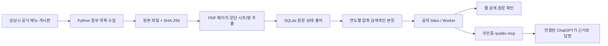

# 구성과 데이터 흐름

수집기는 운영자 컴퓨터에서 실행한다. 공개 Worker가 방문자의 요청으로 성남시 파일을 새로 다운로드하지 않는다. 배포된 스냅샷만 읽으므로 검색 요청이 시청에 반복 다운로드를 발생시키지 않는다.

원본 바이너리는 data/raw, 처리 상태와 페이지는 SQLite, 배포 자료는 snapshot에 둔다. 자료 공개 URL·SHA-256·수집 시각을 유지한다. API에 원본 파일이나 임의 URL을 입력받는 쓰기 도구는 없다.

한국어는 두 글자 단위, 영문·숫자는 단어 단위로 색인한다. 검색어를 FNV-1a로 256개 묶음 중 하나에 배정해 해당 단어의 역색인만 읽는다. 전체 어휘 사전을 메모리에 올리지 않는다. 일치하는 전역 페이지 ID를 구한 뒤 연도·분류·편성 구분을 적용하고, 작은 페이지 메타데이터를 최대 4개씩 읽는다. 페이지 길이·검색어 희소도·문서 제목을 반영해 정렬하고 동일한 텍스트 해시를 제거한다. 각 본문 shard는 최대 1,000개 페이지/본문 블록이며 런타임 자산 캐시는 2개로 제한한다. 정렬 후보는 상위 1,000개까지 보관하고 그 안에서 텍스트 중복을 제거한다.

PDF의 물리적 쪽수는 1부터 센다. HWP·HWPX는 본문 블록, Excel은 시트/행으로 인용한다. API의 page는 조회 키이고 pdf_page는 PDF에서만 유효하다. ZIP은 내부 파일명과 해당 파일의 쪽수를 제공한다. 빈 페이지가 있어도 뒤쪽 PDF 쪽수는 앞당기지 않는다.

build_rag_context는 최대 4개 원문을 반환하며 자체 생성 모델을 호출하지 않는다. ChatGPT 등 클라이언트가 인용 근거를 읽고 답한다. 의미 검색·리랭킹은 아래 2026-11-08 확장으로 구현했다. 자동 금액 합산은 구현하지 않았다.

Sites 기본 /mcp는 플랫폼 인증 경로다. 사용자가 요구한 외부 공개 이용을 위해 동일한 읽기 전용 도구를 /public-mcp에 노출하고 익명 POST를 검증한다. 사이트·MCP에 방문자 계정, 개인 자료, 외부 API 키는 필요하지 않다.

## 2026-11-08 의미 검색 구현

- 임베딩: `minishlab/potion-multilingual-128M`, revision `73908c3438cf03b6a01bcb9611d62b23d0726f08`. BGE-M3를 증류한 다국어 정적 토큰 임베딩, 256차원, mean pooling + L2 정규화. 라이선스 MIT.
- 범위: 검색 가능 원문 112,386개 위치를 모두 596,870개 구간으로 벡터화. 구간은 최대 800 Unicode 문자, 겹침 120자, 가능한 줄바꿈을 경계로 사용한다. 미추출 PDF·실패 자료까지 벡터화했다는 뜻은 아니다.
- 저장·검색: 대칭 int8 벡터, float32 scale, cosine IVF256, nprobe 24. 모든 토큰 어휘·가중치는 정적 자산으로 보관하고, 원문에서 사용한 토큰 15,507개는 작은 공통 캐시에 올린다. 질문도 같은 모델로 서버에서 임베딩한다.
- 결합: 벡터 후보 64개와 키워드 후보 20개를 RRF(k=60)로 결합하고 상위 32개 후보를 재정렬한다. 연도·유형·회차·분류 필터는 벡터 후보 단계부터 적용한다.
- 리랭커: `potion-token-maxsim-v1`. 질문과 본문의 토큰 임베딩으로 MaxSim을 계산한다. 최종 점수 = 0.55 × chunk cosine + 0.35 × 학습된 토큰 norm으로 가중한 평균 token MaxSim + 0.10 × 정규화 RRF. 별도로 학습한 cross-encoder나 ColBERT 모델이 아니다. 이 경량 방식의 정밀도는 별도 사람 정답셋으로 추가 검증해야 한다.
- 응답: `retrieval`에 실제 모델·탐색 수·후보 수·재정렬 여부·소요 시간을 반환한다. 근거마다 cosine/MaxSim/RRF/원문 구간 위치를 포함한다. `mode=hybrid`가 기본이며 `vector`, `lexical` 비교 모드도 제공한다.
- 공개 운영: Sites Worker 내부에서 추론과 벡터 검색을 실행한다. 외부 모델 API, 방문자 로그인, PC 상시 실행, 임시 터널이 필요하지 않다. API 키를 만들지 않았다. 사이트와 `/public-mcp`는 공개다.
- 한계: 정적 임베딩은 문맥형 Transformer보다 어순·부정·정교한 문맥 구분이 약할 수 있다. 검색 근거를 연결된 GPT가 읽고 인용하여 답한다. OCR·자동 금액 합산·사이트 자체 생성 챗봇·자동 최신화는 여전히 미구현이다.

모델 근거: https://huggingface.co/minishlab/potion-multilingual-128M
토큰 단위 late interaction 아이디어: https://arxiv.org/abs/2004.12832 (본 구현이 ColBERT 모델이라는 뜻은 아님)

모델 가중치 정적 저장소: https://seongnam-budget-model-assets-20261108.gnudas0923.chatgpt.site (공개). Sites의 256MiB 배포 아카이브 제한에 맞춰 드문 질문 토큰의 int8 가중치 116MB를 별도 공개 Sites로 분리했다. 원문에서 사용한 토큰·어휘·IVF 인덱스·본문은 검색 서버에 유지한다. 런타임은 고정한 이 origin의 tokens-N.bin.gz만 읽으며 임의 URL을 받지 않는다. 저장소에 모델 추론 API나 API 키는 없다. 모델 공급원 변경 시 main Worker의 origin 및 manifest를 함께 바꾸고 검사한다.

## 2026-11-08 MCP 중심 연동 보완

서비스 역할은 RAG 검색과 원문 근거 반환이다. 생성 답변은 연결된 GPT가 수행한다. 서버에 Luna 답변·LLM 리랭킹·모델 API 키 의존성을 추가하지 않는다. 공개 /public-mcp의 익명 접근을 유지한다.

기본 진입점은 budget_research: 검색·리랭킹 후 최대 4개의 원문 근거, 위치, 단위, 출처, 수집 한계를 함께 반환한다. 각 근거는 최대 6,000 Unicode 문자이며 잘림과 원문 구간을 명시한다. 이미 충분한 근거를 받은 GPT는 같은 검색·상태·전문 조회를 반복할 필요가 없다. 비교 질문은 연도별로 조회하고 편성 구분을 맞춘다.

ChatGPT 리서치 호환 search(query) → fetch(id)를 추가했다. id/title/url 및 전문·metadata, 출력 JSON Schema를 제공한다. 기존 도구 5개도 유지하여 총 8개 읽기 전용 도구를 노출한다. GPTs Actions 호환 /openapi.json은 같은 /api/research, /api/page, /api/status를 기술한다. 상세 연결은 MCP_CONNECT.md를 따른다.

성능 변경: 동일 샤드의 페이지·본문을 묶어 읽고, 전체 키워드 후보 순위에 필요한 문서 인덱스·문자 수·단위 여부·정확한 중복 식별자를 rank.bin.gz에 저장한다. 112,386개 위치의 누락과 catalog SHA-256을 검증한다. build.mjs가 매 빌드에 이 자산을 재생성한다. 검색 결과 캐시는 인스턴스 메모리에서 5분/12건/약 2MB로 제한하며 필터별로 분리한다. vector/lexical/hydrate/rerank 단계 시간을 반환한다. 원문·임베딩·점수 공식은 변경하지 않았다.

검증: Node 21개 검사(기존 의미 모델 3개 + Worker 18개), 공식 MCP SDK 1.32.2의 Streamable HTTP 무인증 연결, 4개 기준 질의의 상위 5개 ID·순위·점수·청크 경계 동일성, 인용 본문 구간의 원문 일치, search/fetch 출력 스키마, 캐시 필터 분리. 로컬 기준선의 자산 읽기는 80→49, 72→36, 215→102, 64→38회. 로컬 처리 시간은 시스템 부하에 따라 변하며 실서버 기록과 구분한다. 별도 모델 API 호출을 하지 않았다.

남은 범위: 미추출 PDF·구형 HWP와 부서별 산발 자료, 자동 동기화, 독립된 사람 정답셋 기반 정확도 평가, 장기 부하 검증. 공개 MCP 배포가 ChatGPT 공개 플러그인 디렉터리의 심사·게시 완료를 의미하지 않는다.

## 기본 조회 및 예산 분류 (2026-11-08)

연도 미지정은 **2026년**입니다. 명시 연도를 우선하고 전체 연도는 `year_scope=all`로 조회합니다. 사업별 답변에는 담당 부서·정책사업·단위사업·세부사업·편성목·통계목을 기본 표시하며 미확인 값은 추정하지 않습니다. [조회 정책](QUERY_POLICY.md)과 [사례 검토](MCP_DESIGN_REVIEW.md)에 세부 규칙이 있습니다.
